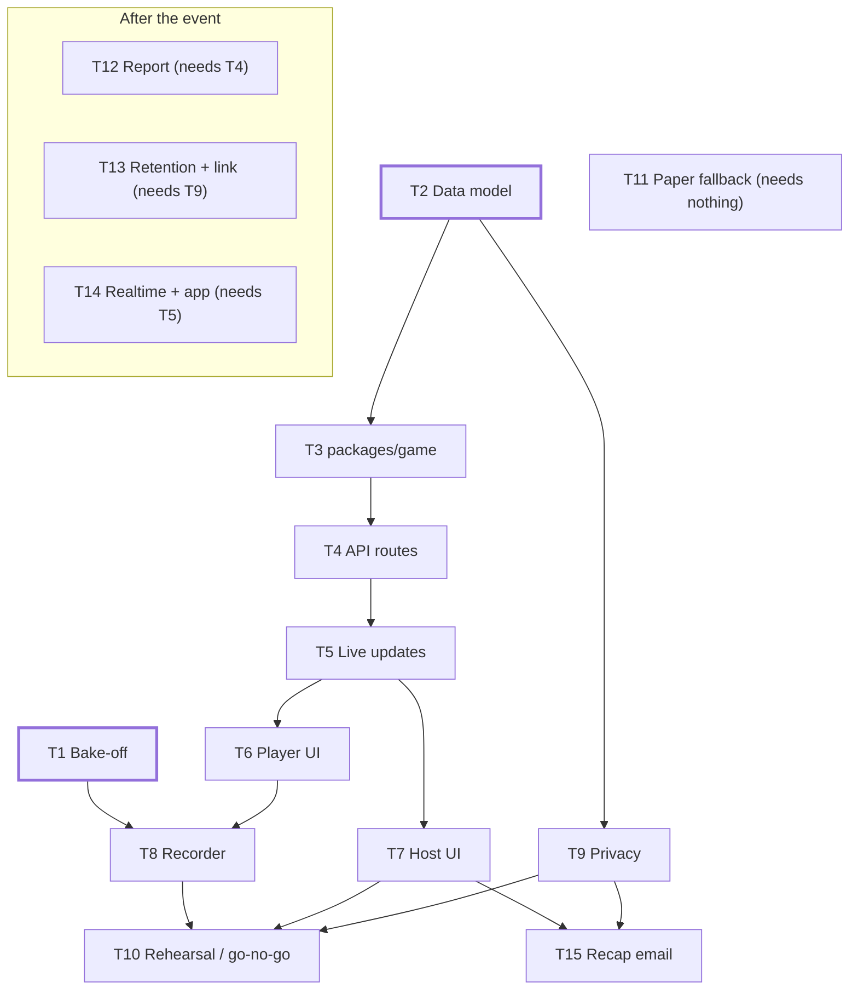
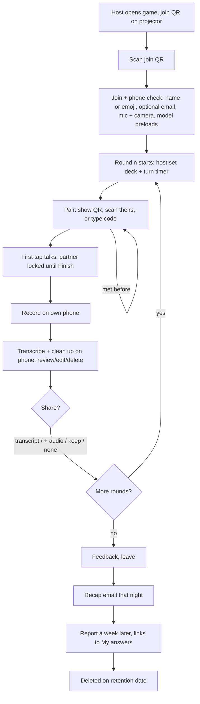
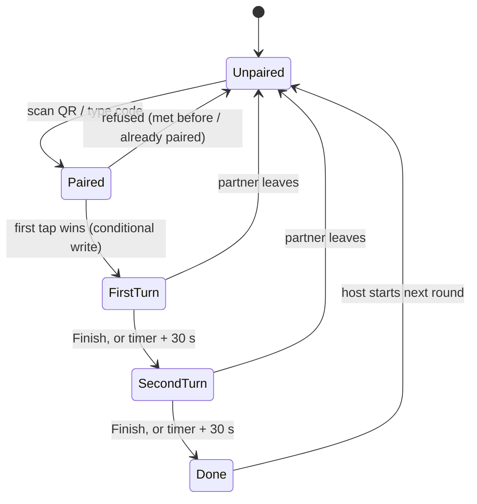
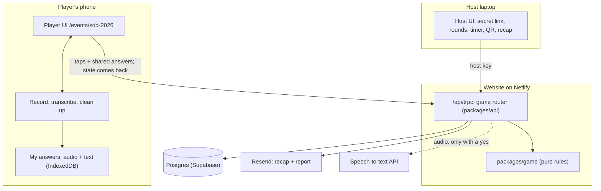

# SDD 2026 workshop: hosted game + recording

Date: 2026-10-10 · Live doc: [SDD workshop build plan](https://claude.ai/code/artifact/1fe9094b-fbd2-484b-8292-d71c8b11d2a9)

Build reusable hosted-game engine (join, pair, take turns, record, reflect). First use: SDD workshop under `/events/sdd-2026`.
Speech transcribed on phone; API only fallback, only with a yes. Declining never blocks play.
Event **Thu 2026-10-15**. **Go/no-go Wed 2026-10-14** rehearsal: not rehearsed on real phones → run on paper.
**Blocking now:** T1 model bake-off (English + Hungarian), T2 data model. Open questions all decided, see Decisions.
**Built for mobile:** rules, API, data hooks, copy = shared packages. Only screens + device adapters per platform.

## Tasks

| #   | Task                                                                                                                                                      | Priority | Needs      |
| --- | --------------------------------------------------------------------------------------------------------------------------------------------------------- | -------- | ---------- |
| T1  | Bake-off page + clips: STT and cleanup candidates on real phones, log numbers                                                                             | P0       | —          |
| T2  | Glossary terms, data model, Drizzle migration                                                                                                             | P0       | —          |
| T3  | `packages/game`: round state machine, pairing (no repeats; trio/sit-out setting), turn lock, timer (nudge + extra / hard stop), adapter interfaces, tests | P0       | T2         |
| T4  | `game` tRPC router in `packages/api`                                                                                                                      | P0       | T3         |
| T5  | Shared data hooks: state from every call, refresh only on waiting screens                                                                                 | P0       | T4         |
| T6  | Player UI: join + phone check, pair (show/scan/type code), card + turn lock, timer, decline flow                                                          | P0       | T4, T5     |
| T7  | Host UI: rounds, deck + timer per round, start/end, live counts, join QR                                                                                  | P0       | T4, T5     |
| T8  | Recorder + screen wake lock, on-device STT + cleanup, review screen, share choices, API fallback                                                          | P0       | T1, T6     |
| T9  | Privacy notice (joint controllers), consent copy, My answers (view, download, delete)                                                                     | P0       | T2         |
| T10 | Rehearsal: 6–10 phones, iOS + Android, noisy room, throttled Wi-Fi, power-saving on                                                                       | P0       | T6–T9      |
| T11 | Paper fallback kit: printed cards, reflection slip                                                                                                        | P0       | —          |
| T15 | Recap email that night: stats, template, random question, host preview + send                                                                             | P0       | T4, T7, T9 |
| T12 | Report script: export, Claude, personal + group reports, Resend                                                                                           | P1       | T4         |
| T13 | Retention deletion job; magic link to My answers                                                                                                          | P1       | T9         |
| T14 | Supabase Realtime, facilitator role in `apps/app`, mobile screens on shared hooks + native adapters                                                       | P2       | T5         |

### Five days to Thursday

| Day           | Work                                                                                       |
| ------------- | ------------------------------------------------------------------------------------------ |
| Sat 10–Sun 11 | T1 clips + first model runs; T2 schema; T3 engine + tests; T9 notice draft; T11 print list |
| Mon 12        | T4 router; T5 hooks; T6 player screens; T7 host screen                                     |
| Tue 13        | T8 recorder + chosen model; T9 My answers; T15 stats + template                            |
| Wed 14        | T10 rehearsal → go/no-go; print T11 either way                                             |
| Thu 15        | Event; recap email that night                                                              |

Headcount unknown → plan + load-test for 60. Slip → cut in order: cleanup model (rules only), audio-upload tier, Hungarian transcription (record + keep, transcribe later), host screen polish (settings in config).

## How it works

## Pairing and turns

No long polling. Answers go up from the phone; timer runs on the phone from round `started_at` (offset by server clock). Only partner scan, partner turn start/finish and host's next round happen elsewhere. Every call returns state, so every tap syncs; phones refresh every 3–5 s only on waiting screens and on foreground. Partner card not greyed yet → server still refuses the second tap ("Your partner is answering"). Well under 20k calls/hour at 40–60 people. Realtime can replace the refresh later (T14) without touching screens.

## Architecture

## Risks

| Risk                                                  | L / I       | Mitigation                                                        |
| ----------------------------------------------------- | ----------- | ----------------------------------------------------------------- |
| Venue Wi-Fi can't serve ~40 model downloads           | H / H       | Download at welcome, Cache Storage, smaller fallback model        |
| Transcripts name colleagues / reveal sensitive things | H / H       | Names replaced on phone, review before upload, consent per answer |
| Netlify invocations from keeping phones in sync       | L / M       | No long polling; state on every call; refresh only while waiting  |
| Not rehearsed by 2026-10-14 (five days)               | H / H       | Paper fallback T11 always ready; cut list above                   |
| iOS kills backgrounded tab                            | H / M       | Screen wake lock while recording; audio to IndexedDB; resume      |
| On-device STT slow on older phones                    | M / M       | Transcribe between turns; API fallback with a yes                 |
| Joint controllers without written arrangement         | M / M       | Short Art. 26 note: who answers requests; notice names both       |
| Engine overfit to this event                          | M / M       | Own package, pure logic, event config is data                     |
| Two permission prompts eat round time                 | H / L       | 30 s phone check at join; typed code fallback                     |
| Odd headcount / nobody new left                       | certain / L | Trio (facilitator setting); relax no-repeat after timeout         |
| Partner leaves mid-round                              | M / L       | Host ends pair; turn auto-finishes                                |

## Decisions (2026-10-10)

1. **Naming:** add Hosted Game, Round, Pair, Turn, Response to `CONTEXT.md`. Spoken thing = Response, no clash with Answer.
2. **Live updates:** no long polling. Answers from phone, timer on phone, state on every call, waiting screens refresh.
3. **Host auth:** secret link now; facilitator accounts later.
4. **Where:** website now. Rules, API, hooks in packages → cheap move to `apps/app` / mobile. TanStack Start move is its own track, doesn't block this.
5. **Controller:** Avi + Tamas / Unloop, joint.
6. **Date:** Thu 2026-10-15. Headcount unknown, plan for 60.
7. **Odd headcount:** trio, facilitator setting.
8. **Timer end:** soft nudge + 30 s, facilitator setting.
9. **Languages:** English + Hungarian.
10. **Pair QR:** in-page scanner; typed code for fallback + testing.

For AI

### Engine boundary

`packages/game` has no DB and no HTTP: `(state, action) → next state | refusal`. The API loads state, calls engine, persists. See Built for mobile for what else is shared. Turn start is a conditional write (`active_turn is null`), so simultaneous taps yield one speaker. No-repeat is a uniqueness check on the game's pair history. Timer authority is `game_round.ends_at`.

### API: `game` tRPC router in `packages/api`

Per ADR-0002: website already serves `packages/api` at `/api/trpc` (`apps/website/src/pages/api/trpc/[trpc].ts`); `apps/mobile/src/lib/trpc.ts` already has the typed client. The URL shape from requirement (e) becomes procedure names, all scoped by game id. Audio uploads to a signed URL returned by `game.round.response`, not through tRPC.

| Procedure                            | Who                | Does                                                                       |
| ------------------------------------ | ------------------ | -------------------------------------------------------------------------- |
| `game.join`                          | player             | Turnstile (web, own action); create player; device token + pair code       |
| `game.state`                         | player, host       | round, settings, `started_at`, my pair, whose turn; returned by every call |
| `game.round.pair`                    | player             | pair by partner code; refuse repeat                                        |
| `game.round.turn`                    | player             | start/finish my turn; refused while partner talking                        |
| `game.round.response`                | player             | shared transcript (+ audio upload URL if chosen); only after a yes         |
| `game.me` / `game.me.deleteResponse` | player             | what we hold; withdraw                                                     |
| `game.feedback`                      | player             | end-of-game feedback                                                       |
| `game.host.*`                        | host (secret link) | configure/start/end rounds, settings, end a pair, preview/send recap       |

### Data model

| Table           | Holds                                                                                                                  | Rule                                                    |
| --------------- | ---------------------------------------------------------------------------------------------------------------------- | ------------------------------------------------------- |
| `hosted_game`   | slug, deck config, status, host key hash, retention date                                                               | everything below deleted with it                        |
| `game_player`   | device token hash, optional name/emoji, optional email, marketing opt-in                                               | email never required                                    |
| `game_round`    | n, deck, turn seconds, timer end (nudge + extra s / hard stop), odd-player rule (trio / sit out), status, `started_at` | phones count down from `started_at`; server checks taps |
| `game_pair`     | round, two players                                                                                                     | one per player per round; no repeat pair                |
| `game_turn`     | pair, speaker, started, finished                                                                                       | ≤ 1 open turn per pair                                  |
| `game_response` | turn, question id, transcript, source (model/API), audio path, consent choice                                          | only shared items                                       |
| `game_feedback` | player, answers                                                                                                        | —                                                       |

Local `DB_URL` points at prod: migration is additive only, reviewed before running.

### Facilitator controls

Secret host link; rounds, and per round: deck, turn timer, timer end (nudge + extra time, default 30 s, or hard stop), odd-player rule (trio default, or sit out), all editable during the game; start/end round; end a stuck pair; live counts only (joined, paired, talking, done), never content; full-screen join QR; preview + send recap.

### Built for mobile

Test for every piece: could the Expo app use it unchanged?

| Layer                                                                       | Lives in                                        | Web (Thursday)                                                                        | Mobile (later)                                                                              |
| --------------------------------------------------------------------------- | ----------------------------------------------- | ------------------------------------------------------------------------------------- | ------------------------------------------------------------------------------------------- |
| Rules                                                                       | `packages/game`                                 | shared                                                                                | shared                                                                                      |
| API                                                                         | `game` router in `packages/api`                 | website `/api/trpc`                                                                   | same router; tRPC client exists in `apps/mobile`                                            |
| Data hooks (`useHostedGame`, `useTurn`, `useRoundTimer`)                    | `packages/game`, React + TanStack Query, no DOM | shared                                                                                | shared (add TanStack Query to mobile)                                                       |
| Copy: consent, prompts, recap strings                                       | `packages/game`                                 | shared                                                                                | shared                                                                                      |
| Device adapters: recorder, keep-awake, transcriber, local store, QR scanner | interfaces in `packages/game`, impl per app     | MediaRecorder, Screen Wake Lock, transformers.js / Voz JS, IndexedDB, in-page scanner | expo-audio, expo-keep-awake, Voz Swift / whisper.rn, expo-file-system + SQLite, expo-camera |
| Design tokens                                                               | `packages/tokens`                               | shared                                                                                | shared                                                                                      |
| Screens                                                                     | each app                                        | React islands in website                                                              | NativeWind screens in `apps/mobile`                                                         |

Guard: `packages/game` tsconfig omits the `DOM` lib, so browser APIs can't leak into shared code. Web adapters live in the website.

### On-device STT candidates (T1)

| Candidate                                                  | Runtime                                              | Size (approx.)  | Why                                                                                                 | Watch out                                                                                     |
| ---------------------------------------------------------- | ---------------------------------------------------- | --------------- | --------------------------------------------------------------------------------------------------- | --------------------------------------------------------------------------------------------- |
| Moonshine Tiny / Base                                      | transformers.js (WebGPU, WASM)                       | ~27M / ~61M     | built for edge, fastest                                                                             | English only                                                                                  |
| Whisper tiny / base (quantized)                            | transformers.js                                      | ~39M / ~74M     | multilingual                                                                                        | hallucinates on silence; base slow on WASM                                                    |
| Whisper small / distil-small.en                            | transformers.js                                      | ~244M / ~166M   | quality ceiling on device                                                                           | big download                                                                                  |
| whisper.cpp tiny / base q5                                 | WASM                                                 | tens of MB      | runs without WebGPU                                                                                 | own build                                                                                     |
| [Voz](https://desertant.com/models/voz/) (Desert Ant Labs) | JS/TS SDK (WASM + ONNX Runtime); Swift SDK (Core ML) | 467 MB (stated) | Parakeet TDT 0.6B v3; 25 EU langs; 11.8% meeting WER vs Whisper 13.9% (stated); free ≤ 100k devices | 467 MB × 40 phones on venue Wi-Fi; speed claim is native iPhone 17 Pro; no Android native yet |
| Parakeet TDT 0.6B v3 (raw)                                 | sherpa-onnx WASM                                     | ~600M           | same model without vendor; control for Voz                                                          | same weight                                                                                   |
| Web Speech API                                             | browser                                              | 0               | no download, live                                                                                   | not guaranteed on device; cuts on pauses                                                      |

Languages: English + Hungarian. Moonshine (English only) drops to a control; Whisper multilingual and Voz / Parakeet v3 (Hungarian among its 25) lead. Language picked at join; auto-detect unreliable on short clips. Hungarian name replacement weaker → review screen matters more.

Cleanup (punctuation, filler, names → placeholders): rules + BERT-NER (transformers.js, ~100 MB); Gemma 3 270M / 1B (MediaPipe or transformers.js); Qwen3 0.6B / SmolLM2 360M (WebLLM); Chrome built-in AI (Gemini Nano, likely desktop only). Desert Ant [UhmFiller](https://desertant.com/models/uhm/) and [Ear](https://desertant.com/models/ear/) worth testing if Voz works.

API fallback (only with a yes; key server-side): OpenAI `gpt-4o-mini-transcribe` / `gpt-4o-transcribe`, Deepgram Nova-3, ElevenLabs Scribe, Groq `whisper-large-v3-turbo`, Mistral Voxtral. API cleanup: Claude Haiku 4.5.

Bake-off protocol:

1. 8–10 two-minute clips: native English, Hungarian-accented English, three Hungarian, café noise, two people talking nearby.
2. Hand-transcribe once as ground truth.
3. Per model on iPhone (iOS 26 Safari) + mid-range Android (Chrome): download size, time to ready, time to transcribe 2 min, WER, heat/battery, crashes.
4. Proposed bar: 2 min transcribed ≤ 60 s on mid-range phone, download ≤ ~100 MB, WER within ~5 points of API.

### Screen wake lock (T8)

Locked phone = iOS stops mic = recording ends. Use [Screen Wake Lock API](https://developer.mozilla.org/en-US/docs/Web/API/Screen_Wake_Lock_API) `navigator.wakeLock.request('screen')`: Chrome Android, Safari iOS 16.4+ (Home Screen web apps since 18.4), Firefox 126+; HTTPS only.

- Acquire on Record tap; release on Finish / turn end.
- Browser releases it when tab hidden → re-acquire on `visibilitychange` while still recording.
- Request can reject (low battery, power saving) → show "Keep your screen on", carry on; audio already in IndexedDB.
- Older browsers: [NoSleep.js](https://github.com/richtr/NoSleep.js) (hidden looping video), only if rehearsal shows the need.
- T10 checks: iPhone in Low Power Mode, Android battery saver, phone untouched through a 3-minute turn.

### Consent and decline flow

Play never depends on consent; consent decides only what leaves the phone, asked after each answer, transcript shown first (editable, deletable).

| Choice                         | Reaches us                             | Person keeps                       | Report                     |
| ------------------------------ | -------------------------------------- | ---------------------------------- | -------------------------- |
| Share transcript (default ask) | cleaned transcript, question id, round | transcript on phone, .txt download | personal + group           |
| Share transcript + audio       | above + audio                          | same                               | personal + group           |
| Keep it to myself              | "answered: yes"                        | transcript + audio on phone        | group only, if email given |
| Don't record                   | nothing                                | nothing                            | group only, if email given |

Decline flow: record button becomes "Just talk"; after the round, one optional anonymous written line; facilitators see counts only.

Data access: My answers on device (view, edit, download .txt/.json, delete); magic link in recap + report emails; delete per answer or all; contact address; auto-delete on retention date.

### GDPR checklist

- Joint controllers (Avi + Tamas / Unloop): short Art. 26 arrangement on who answers requests; notice names both.
- Plain-words privacy notice under the event, linked from join and every consent prompt.
- Art. 9 explicit consent (work/wellbeing answers may reveal health or beliefs); per answer, revocable.
- Processors + regions: Netlify, Supabase (region?), Resend, STT API vendor if used, Anthropic for report; name US transfer basis.
- Retention: audio deleted after transcription; transcripts 30 days after report; game + pairing data with the game.
- Third parties: names replaced before upload; report never quotes identifiable lines.
- One-page DPIA-lite kept with this plan.
- No transcripts on projector or live to facilitators.

### Recap email that night (T15)

To everyone who left an email. Thank-you + recap, not the report.

- Thanks from Avi and Tamas.
- Room in numbers (totals only): people, conversations, rounds, minutes talked, answers recorded, share of answers shared.
- Your game: rounds played, people met (count, never names), minutes you spoke, questions answered, answers shared. Computed server-side from turns, so it works for people who kept everything private.
- One question to take home: random card from the deck they didn't draw (`packages/decks`).
- Links: WhoCards app, event page, My answers (magic link), feedback form if skipped.
- Also: when the report arrives; what happens to their data and when; forward-to-a-colleague link; next event; reply-to a real inbox.

Sending: host ends game → preview to self → Send. React Email template, Resend batch API (≤ 100 per call). Manual on purpose.

Consent: recap is what the email was given for, no extra opt-in. App news / future events = marketing → separate unticked box at join, stored in existing `email_consent` table. Unsubscribe link in every email.

### Reuse pointers

- Join + Turnstile + Resend pattern: `apps/website/src/pages/api/ai-checkin-subscribe.ts`, `apps/website/src/server/turnstile.ts`
- Schema + migrations: `apps/website/src/server/db/schema.ts`, `apps/website/src/server/db/migrations/`
- Card UI: `apps/website/src/components/Play/Play.tsx`; device id: `apps/website/src/lib/answer-event.ts`
- Event page pattern: `apps/website/src/pages/events/hajnalig/`
- Recording gate precedent: `packages/api/src/recording.ts`

